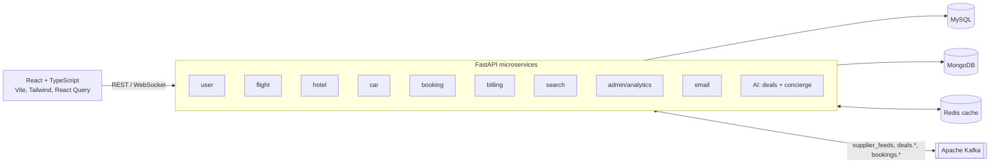

# Kayak Travel Simulation System

> Distributed, microservice-based travel booking platform (flights, hotels, cars) with event streaming over Kafka, Redis caching and a deals/concierge service. Load-tested to about 2,900 requests/s at 100 concurrent users with 0% errors.


## Highlights

- **10 FastAPI microservices**: user, flight, hotel, car, booking, billing, search, admin/analytics, email and AI. They run alongside MySQL, MongoDB, Redis, Kafka and the React frontend as **17 Docker Compose containers**.
- **Polyglot persistence.** MySQL (SQLModel) holds transactional data such as users, listings and bookings; MongoDB (Motor) holds reviews, logs and analytics; Redis caches hot SQL reads.
- **Event-driven.** Kafka topics carry supplier feeds, deals and booking events between services. The AI service pushes live deals to the UI over WebSockets.
- **Measured performance.** Apache JMeter tests with 100 concurrent users across four configurations (results below).
- **Admin analytics.** Revenue by city and listing performance, shown on a React + Recharts dashboard.

## Performance results

100 concurrent users, Apache JMeter (`jmeter/results/`):

| Configuration | Requests | Mean latency | p95 latency | Throughput | Errors |
|---|---:|---:|---:|---:|---:|
| **B**: base | 49,014 | 583 ms | 1,401 ms | 163 req/s | 0% |
| **B+S**: + Redis SQL caching | 866,192 | 33 ms | 81 ms | 2,887 req/s | 0% |
| **B+S+K**: + Kafka | 903,019 | 32 ms | 89 ms | 3,010 req/s | 0% |
| **B+S+K+X**: + additional optimizations | 846,580 | 34 ms | 79 ms | 2,822 req/s | 0% |

**Redis caching cut mean latency about 17× (583 → 33 ms) and raised throughput about 18× (163 → 2,887 req/s).**

<p>
  
  
</p>

## Architecture at a glance



## Quickstart

```bash
git clone https://github.com/IamSavitha/Kayak-Travel-Simulation-System.git
cd Kayak-Travel-Simulation-System
docker-compose up -d     # 17 containers: infra + 10 services + frontend
docker-compose ps
```

The frontend runs on `:3000` and the services on `:8001`–`:8008` (full port table below). Kafka UI is included for inspecting topics.

## My role

<!-- TODO: your contributions (team project) -->

---

# Detailed documentation

## Architecture

```
┌─────────────────────────────────────────────────────────────────────────────┐
│                            CLIENT TIER                                       │
│  ┌─────────────────────────────────────────────────────────────────────┐    │
│  │                    React + TypeScript Frontend                       │    │
│  │  • User Module (Search, Book, Review, Profile)                      │    │
│  │  • Admin Module (Manage Listings, Analytics, Reports)               │    │
│  └─────────────────────────────────────────────────────────────────────┘    │
└────────────────────────────────────┬────────────────────────────────────────┘
                                     │ REST API / WebSocket
┌────────────────────────────────────▼────────────────────────────────────────┐
│                         MIDDLEWARE TIER                                      │
│  ┌──────────────┐ ┌──────────────┐ ┌──────────────┐ ┌──────────────┐       │
│  │ User Service │ │Flight Service│ │Hotel Service │ │ Car Service  │       │
│  │   :8001      │ │   :8002      │ │   :8003      │ │   :8004      │       │
│  └──────────────┘ └──────────────┘ └──────────────┘ └──────────────┘       │
│  ┌──────────────┐ ┌──────────────┐ ┌──────────────┐ ┌──────────────┐       │
│  │Billing Svc   │ │ Admin Service│ │Search Service│ │  AI Service  │       │
│  │   :8005      │ │   :8006      │ │   :8007      │ │   :8008      │       │
│  └──────────────┘ └──────────────┘ └──────────────┘ └──────────────┘       │
│                           │                                │                 │
│                   ┌───────▼────────────────────────────────▼───────┐        │
│                   │              Apache Kafka :9092                 │        │
│                   │  Topics: supplier_feeds, deals.*, bookings.*   │        │
│                   └────────────────────────────────────────────────┘        │
└────────────────────────────────────┬────────────────────────────────────────┘
                                     │
┌────────────────────────────────────▼────────────────────────────────────────┐
│                          DATABASE TIER                                       │
│  ┌──────────────────┐ ┌──────────────────┐ ┌──────────────────┐            │
│  │   MySQL :3306    │ │  MongoDB :27017  │ │   Redis :6379    │            │
│  │ • Users          │ │ • Reviews        │ │ • SQL Caching    │            │
│  │ • Flights        │ │ • Images         │ │ • Sessions       │            │
│  │ • Hotels         │ │ • User Behavior  │ │ • Rate Limiting  │            │
│  │ • Cars           │ │ • Analytics Logs │ │                  │            │
│  │ • Bookings       │ │                  │ │                  │            │
│  │ • Billing        │ │                  │ │                  │            │
│  └──────────────────┘ └──────────────────┘ └──────────────────┘            │
└─────────────────────────────────────────────────────────────────────────────┘
```

## Project Structure

```
kayak-simulation/
├── backend/
│   ├── common/                  # Shared utilities
│   │   ├── config.py           # Configuration management
│   │   ├── database.py         # Database connections
│   │   ├── cache.py            # Redis caching
│   │   ├── validators.py       # Input validation (SSN, ZIP, State)
│   │   └── exceptions.py       # Custom exceptions
│   ├── models/                  # ORM models
│   │   ├── mysql_models.py     # SQLModel entities
│   │   └── mongodb_models.py   # MongoDB document schemas
│   ├── schemas/                 # Pydantic schemas
│   │   ├── user_schemas.py
│   │   ├── flight_schemas.py
│   │   ├── hotel_schemas.py
│   │   ├── car_schemas.py
│   │   ├── booking_schemas.py
│   │   └── billing_schemas.py
│   ├── kafka/                   # Kafka configuration
│   │   ├── topics.py           # Topic definitions
│   │   ├── producer.py         # Kafka producer
│   │   └── consumer.py         # Kafka consumer
│   ├── services/                # Microservices
│   │   ├── user_service/
│   │   ├── flight_service/
│   │   ├── hotel_service/
│   │   ├── car_service/
│   │   ├── billing_service/
│   │   ├── admin_service/
│   │   └── search_service/
│   └── database/
│       ├── mysql/init/         # MySQL initialization scripts
│       └── mongodb/init/       # MongoDB initialization scripts
├── ai_service/                  # AI Recommendation Service
│   ├── main.py                 # FastAPI application
│   ├── agents/
│   │   ├── deals_agent.py      # Deal detection & scoring
│   │   └── concierge_agent.py  # AI trip assistant
│   ├── api/
│   │   ├── routes.py           # HTTP endpoints
│   │   └── websocket.py        # Real-time events
│   └── services/
├── frontend/                    # React TypeScript application
│   ├── src/
│   │   ├── components/         # Reusable components
│   │   ├── pages/              # Page components
│   │   └── services/           # API services
│   └── public/
├── docker/                      # Docker configurations
│   ├── Dockerfile.service      # Backend service image
│   └── Dockerfile.ai           # AI service image
├── tests/
│   ├── unit/                   # Unit tests
│   ├── integration/            # Integration tests
│   ├── performance/            # Load tests (Locust)
│   ├── module8/                # Email notification tests
│   ├── module10/                # AI Concierge tests
│   ├── module11/                # Kafka event-driven tests
│   └── module12/                # MongoDB analytics tests
├── scripts/
│   ├── database/               # Database initialization and seeding
│   ├── kafka/                  # Kafka topic management
│   └── verification/          # System verification scripts
├── docker-compose.yml          # Multi-container orchestration
└── requirements.txt            # Python dependencies
```

## Quick Start

### Prerequisites

- Docker & Docker Compose
- Python 3.10+
- Node.js 18+
- npm or yarn

### Running with Docker

```bash
# Clone the repository
git clone https://github.com/IamSavitha/Kayak-Travel-Simulation-System.git
cd Kayak-Travel-Simulation-System

# Start all services
docker-compose up -d

# Check service health
docker-compose ps
```

### Manual Development Setup

```bash
# Install Python dependencies
pip install -r requirements.txt

# Initialize databases
python scripts/init_databases.py

# Start backend services (in separate terminals)
cd backend/services/user_service && uvicorn main:app --port 8001
cd backend/services/flight_service && uvicorn main:app --port 8002
cd backend/services/hotel_service && uvicorn main:app --port 8003
cd backend/services/car_service && uvicorn main:app --port 8004
cd backend/services/billing_service && uvicorn main:app --port 8005
cd backend/services/admin_service && uvicorn main:app --port 8006

# Start AI service
cd ai_service && uvicorn main:app --port 8008

# Start frontend
cd frontend
npm install
npm run dev
```

## Service Ports

| Service | Port |
|---------|------|
| User Service | 8001 |
| Flight Service | 8002 |
| Hotel Service | 8003 |
| Car Service | 8004 |
| Billing Service | 8005 |
| Admin Service | 8006 |
| Search Service | 8007 |
| AI Service | 8008 |
| Frontend | 3000 |
| MySQL | 3306 |
| MongoDB | 27017 |
| Redis | 6379 |
| Kafka | 9092 |

## API Overview

### User Service
- `POST /users` - Create user (validates SSN, ZIP, State)
- `GET /users/{user_id}` - Get user details
- `PUT /users/{user_id}` - Update user
- `DELETE /users/{user_id}` - Delete user

### Flight Service
- `GET /flights/search` - Search with filters
- `GET /flights/{flight_id}` - Get flight details
- `POST /flights` - Create flight (Admin)
- `PUT /flights/{flight_id}` - Update flight (Admin)

### Hotel Service
- `GET /hotels/search` - Search with filters
- `GET /hotels/{hotel_id}` - Get hotel details

### Car Service
- `GET /cars/search` - Search rentals
- `GET /cars/{car_id}` - Get car details

### Billing Service
- `POST /payments` - Process payment
- `GET /billings/{billing_id}` - Get billing record
- `GET /billings` - Search billing records

### Admin Service
- `GET /analytics/revenue` - Revenue analytics
- `GET /analytics/top-properties` - Top performing properties
- `GET /analytics/city-revenue` - City-wise breakdown

### AI Service
- `GET /api/deals` - Get current deals
- `POST /api/bundles` - Find trip bundles
- `POST /api/chat` - Chat with concierge
- `WS /ws/events` - Real-time deal updates

## Validation Rules

| Field | Format | Example |
|-------|--------|---------|
| User ID (SSN) | XXX-XX-XXXX | 123-45-6789 |
| ZIP Code | XXXXX or XXXXX-XXXX | 95123, 95123-4567 |
| State | 2-letter abbreviation | CA, NY, TX |

## Testing

```bash
# Run unit tests
pytest tests/unit/ -v

# Run integration tests
pytest tests/integration/ -v

# Run load tests
cd tests/performance
locust -f load_test.py --host=http://localhost:8001
```

## Additional Resources

- Module testing guides: See `tests/README.md` for test scripts
- Implementation guides: See project structure for module-specific guides
- OpenAPI Specs: Available at `/docs` on each service

## Technology Stack

**Backend:**
- Python 3.10+
- FastAPI
- SQLModel (MySQL ORM)
- Motor (MongoDB async driver)
- aiokafka (Kafka client)
- redis-py (Redis client)
- Pydantic v2 (validation)

**Frontend:**
- React 18
- TypeScript
- Tailwind CSS
- Axios
- React Query

**Infrastructure:**
- Docker & Docker Compose
- Apache Kafka
- MySQL 8
- MongoDB 6
- Redis 7

**AI service:**
- Rule-based intent parsing and constraint extraction (concierge)
- Kafka-driven deal scoring and tagging (deals agent)
- WebSocket push for live deals

## Team

Built by a team working in parallel feature streams (user/admin/AI, listings, booking and reviews, billing and payments, Kafka/Redis, testing and deployment), integrated in three phases: foundation, services, final.
